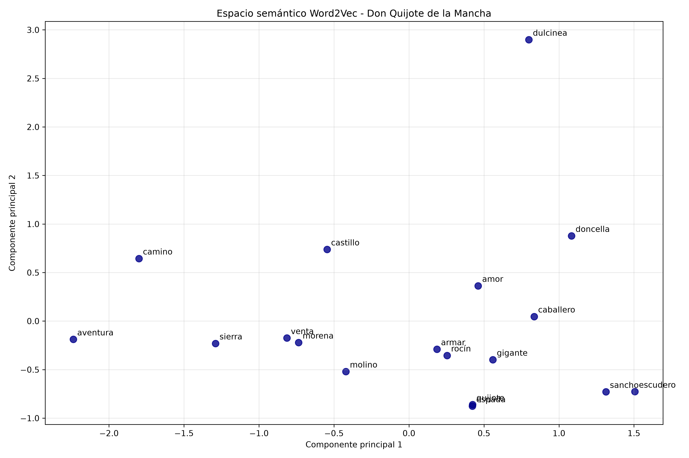
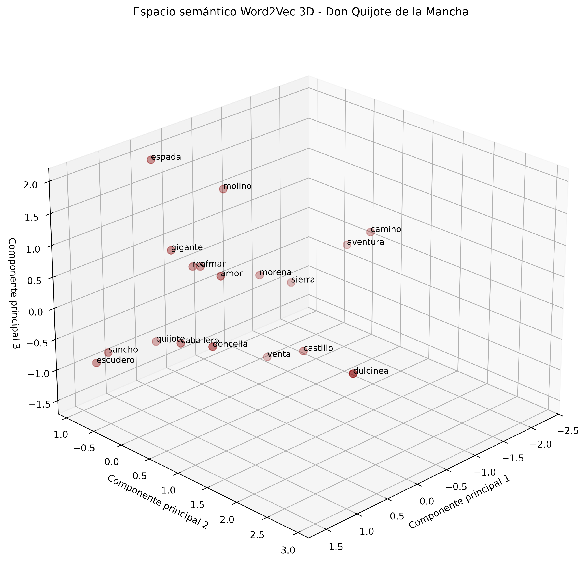

# Normalización, Lematización y Semántica Distribucional de Texto

## Descripción

Proyecto académico de Procesamiento de Lenguaje Natural (PLN) desarrollado en Python.

Se utiliza la obra _Don Quijote de la Mancha_, de Miguel de Cervantes, para aplicar técnicas de limpieza, normalización, lematización y representación vectorial del lenguaje.

El proyecto permite estudiar tanto el procesamiento lingüístico del texto como las relaciones semánticas entre palabras mediante el algoritmo Word2Vec.

## Técnicas implementadas

### 1. Normalización y procesamiento del texto

- Tokenización mediante spaCy.
- Eliminación de palabras vacías (_stop words_).
- Eliminación de signos de puntuación y espacios.
- Conversión de palabras a minúsculas.
- Lematización.
- Comparación entre stemming y lematización utilizando NLTK.
- Generación de un archivo de texto normalizado.

### 2. Semántica distribucional

- Segmentación del libro en oraciones.
- Normalización de palabras mediante spaCy.
- Entrenamiento de un modelo Word2Vec utilizando Gensim.
- Representación de palabras mediante vectores de 50 dimensiones.
- Identificación de palabras relacionadas mediante similitud semántica.
- Almacenamiento del modelo entrenado.

### 3. Visualización de espacios vectoriales

Se utiliza el algoritmo de Análisis de Componentes Principales (PCA) para reducir la dimensionalidad de los vectores y representarlos gráficamente.

Se generan dos visualizaciones:

- **2D:** representación de palabras en un espacio bidimensional.
- **3D:** representación tridimensional de las relaciones entre palabras.

Las distancias entre los puntos permiten explorar las relaciones aprendidas por Word2Vec. Las visualizaciones son aproximaciones obtenidas mediante reducción de dimensionalidad.

## Tecnologías

- Python 3.12
- spaCy
- NLTK
- pandas
- Gensim
- NumPy
- Matplotlib
- scikit-learn

## Estructura del proyecto

```text
normalizacion-texto/
├── main.py
├── vectorizacion.py
├── libro.txt
├── texto_normalizado.txt
├── word2vec_quijote.model
├── espacio_semantico_word2vec_2d.png
├── espacio_semantico_word2vec_3d.png
├── requirements.txt
├── README.md
└── .gitignore
```

## Instalación

Se recomienda utilizar Python 3.12.

Crear un entorno virtual:

```bash
python3.12 -m venv .venv
```

Activarlo en macOS o Linux:

```bash
source .venv/bin/activate
```

Instalar las dependencias:

```bash
python -m pip install -r requirements.txt
```

El archivo de dependencias incluye el modelo `es_core_news_sm` de spaCy.

## Ejecución

### Normalización y lematización

```bash
python main.py
```

Este programa procesa el libro y genera el archivo `texto_normalizado.txt`.

### Entrenamiento Word2Vec y visualizaciones

```bash
python vectorizacion.py
```

Este programa realiza las siguientes operaciones:

1. Carga el libro original.
2. Segmenta y normaliza las oraciones.
3. Entrena el modelo Word2Vec.
4. Consulta palabras semánticamente relacionadas.
5. Guarda el modelo entrenado.
6. Genera las representaciones gráficas en 2D y 3D.

## Resultados

### Normalización

Se genera el archivo `texto_normalizado.txt`, que contiene el texto procesado.

### Modelo Word2Vec

El entrenamiento realizado sobre _Don Quijote de la Mancha_ produjo:

- 32,997 oraciones procesadas.
- 5,723 palabras en el vocabulario.
- 50 dimensiones por vector.
- 15 épocas de entrenamiento.
- Arquitectura Skip-gram.

El modelo se almacena en `word2vec_quijote.model`.

### Visualización 2D



### Visualización 3D



## Propósito académico

Comprender cómo las técnicas de normalización y lematización permiten reducir las variaciones morfológicas del lenguaje natural.

Además, explorar cómo los modelos de semántica distribucional representan palabras mediante vectores numéricos y permiten identificar relaciones semánticas a partir de sus contextos de aparición.

El proyecto integra el procesamiento lingüístico, el aprendizaje de representaciones vectoriales y la visualización de datos.
